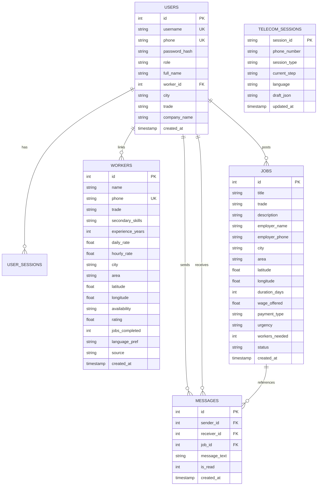

# 🛠️ KaayakaSetu (ಕಾಯಕಸೇತು / श्रमसेतु) — Comprehensive Project Documentation

---

## 📑 Table of Contents
1. [Executive Summary & Vision](#1-executive-summary--vision)
2. [Problem Statement & Target Audience](#2-problem-statement--target-audience)
3. [System Architecture & Design Patterns](#3-system-architecture--design-patterns)
4. [Technology Stack](#4-technology-stack)
5. [Core Features & Modules](#5-core-features--modules)
   - [5.1 Zero-Friction Authentication & Role-Based Access Control (RBAC)](#51-zero-friction-authentication--role-based-access-control-rbac)
   - [5.2 Multi-Factor Smart Matching Engine](#52-multi-factor-smart-matching-engine)
   - [5.3 Fair Wage Prediction & Anti-Exploitation Engine](#53-fair-wage-prediction--anti-exploitation-engine)
   - [5.4 Regional IVR Telephony Gateway (Twilio & Web Simulator)](#54-regional-ivr-telephony-gateway-twilio--web-simulator)
   - [5.5 Real-Time 1-to-1 Private Chat & Messaging (WebSockets)](#55-real-time-1-to-1-private-chat--messaging-websockets)
   - [5.6 Geodesic Distance & Location Intelligence Service](#56-geodesic-distance--location-intelligence-service)
   - [5.7 Worker & Job Marketplace Feeds](#57-worker--job-marketplace-feeds)
6. [Database Architecture & Schema Reference](#6-database-architecture--schema-reference)
7. [API Specification & Endpoints](#7-api-specification--endpoints)
8. [Frontend Design & User Experience](#8-frontend-design--user-experience)
9. [Installation, Configuration & Local Development](#9-installation-configuration--local-development)
10. [Cloud Deployment & Dockerization](#10-cloud-deployment--dockerization)
11. [Testing Suite & Quality Assurance](#11-testing-suite--quality-assurance)
12. [Future Roadmap & Extensibility](#12-future-roadmap--extensibility)

---

## 1. Executive Summary & Vision

**KaayakaSetu** (translating to *Bridge of Dignified Labor* — Kannada: ಕಾಯಕಸೇತು, Hindi: श्रमसेतु) is a production-ready, modular microservices platform created specifically for the informal blue-collar workforce and their employers across India.

Traditional employment platforms (such as LinkedIn, Indeed, or Naukri) cater primarily to white-collar professionals with resumes, desktop access, and high literacy levels. On the opposite side, informal gig platforms often extract heavy commissions, impose rigid algorithmic scheduling, or suffer from severe language barriers.

**KaayakaSetu bridges this gap** by:
- Providing an **offline-first voice entry point** via standard telephone calls (IVR) in regional languages (**Kannada** and **Hindi**), allowing non-smartphone users to register and discover work.
- Preventing economic exploitation through an algorithmic **Fair Wage Predictor** calibrated against Indian economic tiers.
- Minimizing daily transit burdens through **geodesic proximity matching** (Haversine distance).
- Delivering a **zero-leakage, role-separated web portal** with live **WebSocket-based private messaging** for workers and employers.

---

## 2. Problem Statement & Target Audience

### 2.1 The Problem
1. **The Digital Divide**: Millions of skilled tradespeople (electricians, plumbers, masons, carpenters, painters, welders) do not possess high-end smartphones or English literacy to navigate complex job platforms.
2. **Wage Exploitation & Lack of Price Transparency**: Blue-collar workers often face arbitrary underpayment due to middlemen or lack of standard market benchmark rates.
3. **High Transit Friction**: Daily wage laborers spend significant time and money traveling across sprawling urban centers when suitable opportunities exist within their local neighborhood.
4. **Privacy & Harassment**: Publishing personal phone numbers openly on classified boards results in spam and privacy violations.

### 2.2 Target Audience

| Persona | Description | Primary Needs |
| :--- | :--- | :--- |
| **Blue-Collar Workers** | Electricians, Plumbers, Masons, Carpenters, Painters, Welders, Loaders, Helpers. | Instant job discovery within 5–15 km, fair daily wage protection, Kannada/Hindi voice support. |
| **Individual Employers** | Homeowners, apartment residents, small shopkeepers. | Reliable nearby skilled tradespeople, transparent cost estimates, direct contact. |
| **Commercial Contractors** | Builders, renovation contractors, small factories. | Bulk worker sourcing, urgent same-day staffing, multi-worker job postings. |

---

## 3. System Architecture & Design Patterns

The platform is designed around a **clean, layered microservice architecture** powered by FastAPI, featuring modular separation of concerns:

```
                                  ┌───────────────────────────┐
                                  │    Clients & Peripherals  │
                                  └─────────────┬─────────────┘
                                                │
                     ┌──────────────────────────┴──────────────────────────┐
                     │ Web Dashboard (HTML5/CSS3/JS)                       │ Phone Call (Twilio Voice IVR)
                     ▼                                                     ▼
     ┌─────────────────────────────────────────────────────────────────────────────┐
     │                      FastAPI Unified API Gateway                            │
     │            (Routing, CORS, Error Handling, Lifespan DB Init)                │
     └───────┬─────────────┬──────────────┬──────────────┬─────────────┬───────────┘
             │             │              │              │             │
             ▼             ▼              ▼              ▼             ▼
      ┌────────────┐ ┌────────────┐ ┌───────────┐ ┌────────────┐ ┌───────────────┐
      │    Auth    │ │ Workers &  │ │  Smart    │ │ Fair Wage  │ │ Regional IVR  │
      │  Service   │ │ Jobs Feeds │ │ Matching  │ │ Predictor  │ │ Voice Gateway │
      │  (/auth)   │ │  (/feeds)  │ │  (/match) │ │  (/wage)   │ │  (/telecom)   │
      └──────┬─────┘ └─────┬──────┘ └─────┬─────┘ └──────┬─────┘ └───────┬───────┘
             │             │              │              │               │
             ▼             ▼              ▼              ▼               ▼
      ┌────────────┐ ┌───────────────────────────────────────────────────────────┐
      │ Real-Time  │ │              Core Service Layer                           │
      │ Chat (WS)  │ │  (LocationService, WorkerService, JobService, etc.)       │
      │  (/chat)   │ └────────────────────────────┬──────────────────────────────┘
      └──────┬─────┘                              │
             │                                    ▼
             └──────────────────────────► ┌───────────────┐
                                          │ SQLite (WAL)  │
                                          │ Persistence   │
                                          └───────────────┘
```

### Key Architectural Patterns:
- **Modular Router Pattern**: Every domain (workers, jobs, matching, telecom, auth, chat) has an isolated router mounted onto the central FastAPI application.
- **Service Layer Pattern**: Business logic (e.g. Haversine distance, wage multipliers, TwiML generation, heuristic scoring) is completely separated from HTTP routers into dedicated service classes.
- **Role-Based Workspaces & Scoping**: Smart matching endpoints and dashboard views strictly inspect user context to eliminate data leakage.
- **Bi-Directional Telephony Bridge**: Converts telephony DTMF tones and spoken phrases into structured application records.

---

## 4. Technology Stack

### 4.1 Backend
- **Language**: Python 3.10+ / Python 3.11
- **Framework**: [FastAPI](https://fastapi.tiangolo.com/) (High-performance ASGI framework with automatic OpenAPI documentation)
- **ASGI Server**: [Uvicorn](https://www.uvicorn.org/) (Lightning-fast ASGI server implementation)
- **Data Validation & Schemas**: [Pydantic v2](https://docs.pydantic.dev/) (Strict type safety, serialization, and input coercion)
- **Real-Time Communication**: [WebSockets](https://websockets.readthedocs.io/) (Asynchronous bi-directional duplex communication)
- **HTTP Client**: [HTTPX](https://www.python-httpx.org/) (Async HTTP client for external integrations)

### 4.2 Database & Storage
- **Database Engine**: [SQLite3](https://www.sqlite.org/) with:
  - **WAL Mode (Write-Ahead Logging)**: Enables concurrent reads during active writes.
  - **Foreign Key Enforcement**: `PRAGMA foreign_keys = ON`.
  - **Custom Row Factory (`dict_factory`)**: Returns rows as native Python dictionaries.
  - **Connection Pooling**: Context-managed `get_db()` with automatic commit and rollback.

### 4.3 Telephony & Speech Synthesis
- **Telephony Provider**: [Twilio Voice API](https://www.twilio.com/docs/voice)
- **Markup Format**: TwiML (Twilio Markup Language - XML)
- **Speech Engine (Hindi)**: Amazon Polly Neural TTS (`Polly.Aditi` voice)
- **Speech Engine (Kannada)**: Google Cloud Neural TTS (`Google.kn-IN-Standard-A` voice)
- **Voice Ingestion**: Dual-mode DTMF keypad tone detection and Speech-to-Text (`SpeechResult`).

### 4.4 Frontend
- **Markup & Layout**: Clean, semantic HTML5 Single Page Application (SPA).
- **Styling**: Vanilla Modern CSS3 with CSS Custom Properties (Theme variables), flexbox/grid, and native responsive design.
- **Logic & Interactivity**: Vanilla Modern JavaScript (ES6+), async/await, native WebSockets client, and Web Speech API synthesis for in-browser audio simulation.

### 4.5 Testing & DevOps
- **Test Framework**: [Pytest](https://docs.pytest.org/) & FastAPI `TestClient`
- **Containerization**: Multi-stage, non-root [Docker](https://www.docker.com/) image based on `python:3.11-slim-bookworm`
- **Container Orchestration**: Docker Compose with volume persistence
- **Cloud Deployment**: Render Cloud Infrastructure ([Render Blueprint `render.yaml`](https://render.com/))

---

## 5. Core Features & Modules

### 5.1 Zero-Friction Authentication & Role-Based Access Control (RBAC)

The platform implements a secure, role-separated authentication gate:
- **Password Security**: Cryptographically salted SHA-256 password hashing.
- **Session Tokens**: Stateless token generation mapped to active database sessions.
- **Role Isolation**:
  - **Worker Workspace**: Defaults to the Live Job Feed, Personal Smart Matching, Regional Voice Simulator, Fair Wage Predictor, and Private Chat.
  - **Employer Workspace**: Defaults to the Available Workers Feed, Post Work Requirement Form, Candidate Smart Matching, Fair Wage Predictor, and Private Chat.
- **Instant Demo Logins**:
  - `ramesh_worker` (Electrician, Bengaluru)
  - `manjunath_plumber` (Plumber, Bengaluru)
  - `manjunatha_traders` (Shop Owner / Employer)
  - `kiran_constructions` (Contractor / Employer)

---

### 5.2 Multi-Factor Smart Matching Engine (`/api/v1/match`)

Matches workers to jobs (and vice versa) using a multi-factor heuristic scoring algorithm:

$$\text{Composite Match Score} = (0.40 \times \text{Skill}) + (0.30 \times \text{Distance}) + (0.20 \times \text{Wage}) + (0.10 \times \text{Reliability})$$

#### Scoring Dimensions:
1. **Trade & Skill Overlap (40% Weight)**:
   - Exact trade match = `1.0` (100%)
   - Secondary skill keyword match = `0.85` (85%)
   - Related trade match (e.g., Electrician & Inverter repair, Plumber & Tile mason) = `0.70` (70%)
   - General Helper fallback = `0.50` (50%)
   - Unrelated = `0.15` (15%)
2. **Geodesic Travel Distance (30% Weight)**:
   - $\le 5\text{ km}$: `1.0` (100%)
   - $5 - 15\text{ km}$: `0.85` (85%)
   - $15 - 30\text{ km}$: `0.65` (65%)
   - $30 - 50\text{ km}$: `0.40` (40%)
   - $> 50\text{ km}$: `0.10` (10%)
3. **Wage Compatibility (20% Weight)**:
   - Offered rate $\ge$ Worker requested rate: `1.0` (100%)
   - Offered rate within 15% range ($\ge 0.85$ ratio): `0.80` (80%)
   - Offered rate within 30% range ($\ge 0.70$ ratio): `0.50` (50%)
   - Low offer ($< 0.70$ ratio): `0.20` (20%)
4. **Reliability & Availability (10% Weight)**:
   - Rating score ($(\text{Rating} / 5.0) \times 0.6$) + Availability score (`available` = 1.0, `on_call` = 0.7, `busy` = 0.3) $\times 0.4$.

---

### 5.3 Fair Wage Prediction & Anti-Exploitation Engine (`/api/v1/wage`)

Protects vulnerable laborers from underpayment and provides employers with realistic market rates:

$$\text{Recommended Daily Wage} = \left(\text{Base Rate} \times \text{Tier Multiplier} \times \text{Exp Multiplier} \times \text{Urgency Multiplier}\right) + \text{Tool Premium}$$

#### Key Factors:
- **Baseline Daily Rates (8-hr Day)**:
  - Helper / Labour: ₹550
  - Painter: ₹750
  - Plumber: ₹850
  - Carpenter / Electrician / Mason / Welder: ₹900 – ₹950
  - Tile Mason / AC Technician: ₹1000 – ₹1050
- **City Economic Tiers**:
  - **Tier-1** (Bengaluru, Delhi, Mumbai, Hyderabad): `1.25x` (+25%)
  - **Tier-2** (Mysuru, Hubballi, Belagavi, Lucknow, Patna, Jaipur): `1.00x` (Baseline)
  - **Tier-3** (Davanagere, Ballari, Tumakuru, Hassan, Shimoga): `0.85x` (-15%)
- **Experience Compounding**: $+3\%$ per year of experience (capped at 15 years, max +45%).
- **Tool Ownership Allowance**: $+₹150/\text{day}$ for skilled trades; $+₹80/\text{day}$ for semi-skilled trades.
- **Urgency Surcharge**: $+20\%$ for emergency / same-day requirements.
- **Trilingual Rationale**: Instant plain-language explanation generated in **English**, **Kannada**, and **Hindi**.

---

### 5.4 Regional IVR Telephony Gateway (Twilio & Web Simulator)

Enables digital onboarding and job discovery for workers without internet or smartphones:
- **Live Twilio Hotline**: Dial **`+1 (737) 250-8034`** from any phone.
- **Bilingual Greeting**: Greets the caller in Kannada and Hindi to select their language (`1` for Kannada, `2` for Hindi).
- **Subsequent Interaction**: Conducts the entire session strictly in the selected language.
- **Dual Input Modes**: Accepts both keypad DTMF tones and natural spoken speech (e.g., saying *"Electrician"* or *"ಬೆಂಗಳೂರು"*).
- **Feature Phone Web Simulator**: A virtual keypad simulator integrated into the web dashboard that executes the exact same IVR state machine with browser-based speech synthesis audio.

---

### 5.5 Real-Time 1-to-1 Private Chat & Messaging (WebSockets)

A secure communication channel between workers and employers:
- **Real-Time WebSockets**: Instant delivery via an async connection manager.
- **Strict Isolation**: Queries filter exclusively by `(sender_id = :my_id OR receiver_id = :my_id)`. Neither workers nor employers can view unauthorized threads.
- **1-Click Card Initiation**: "💬 Message Employer" on Job Cards and "💬 Message Worker" on Worker Cards instantly opens or creates an isolated conversation with relevant job context.
- **Read Receipts & Unread Badges**: Real-time read status updates and conversation badge counters.

---

### 5.6 Geodesic Distance & Location Intelligence Service

- **Haversine Formula**: Computes precise great-circle distance between coordinate pairs $(lat_1, lon_1)$ and $(lat_2, lon_2)$.
- **Built-in Geo-Centroid Database**: Pre-configured coordinates and economic tiers for over 40 Indian cities across Karnataka, Uttar Pradesh, Bihar, Delhi NCR, and major metros.

---

### 5.7 Worker & Job Marketplace Feeds

- **Live Job Feed**: Lists verified jobs with trade badges, daily wage, duration, urgency indicators, and employer contact.
- **Available Workers Feed**: Lists registered skilled tradespeople with star ratings, verified experience, daily rates, and trade specializations.

---

## 6. Database Architecture & Schema Reference

The platform uses a relational SQLite database (`bluecollar.db`) with Write-Ahead Logging (WAL) and foreign key constraints:



---

## 7. API Specification & Endpoints

| Category | Method | Endpoint | Description |
| :--- | :---: | :--- | :--- |
| **System** | `GET` | `/health` | Healthcheck returning service statuses |
| **Auth** | `POST` | `/api/v1/auth/register` | Register new worker or employer user |
| **Auth** | `POST` | `/api/v1/auth/login` | Authenticate and obtain session token |
| **Auth** | `GET` | `/api/v1/auth/me` | Fetch currently authenticated user profile |
| **Auth** | `POST` | `/api/v1/auth/logout` | Terminate session |
| **Workers** | `GET` | `/api/v1/workers/` | List and search registered workers |
| **Workers** | `POST` | `/api/v1/workers/` | Register new worker profile |
| **Workers** | `GET` | `/api/v1/workers/{id}` | Retrieve specific worker profile |
| **Jobs** | `GET` | `/api/v1/jobs/` | List and search active job postings |
| **Jobs** | `POST` | `/api/v1/jobs/` | Create a new job requirement |
| **Jobs** | `GET` | `/api/v1/jobs/{id}` | Retrieve specific job details |
| **Matching** | `GET` | `/api/v1/match/jobs-for-worker/{id}` | Heuristic job matches for worker |
| **Matching** | `GET` | `/api/v1/match/workers-for-job/{id}` | Heuristic worker matches for job |
| **Matching** | `GET` | `/api/v1/match/scoped` | Role-scoped smart match feed for logged-in user |
| **Fair Wage** | `POST` | `/api/v1/wage/predict` | Calculate fair wage benchmark |
| **Fair Wage** | `GET` | `/api/v1/wage/trades` | List supported trades and baseline rates |
| **Feeds** | `GET` | `/api/v1/feeds/jobs` | Aggregated, filtered job feed |
| **Feeds** | `GET` | `/api/v1/feeds/workers` | Aggregated, filtered worker feed |
| **Feeds** | `GET` | `/api/v1/feeds/stats` | Platform statistics |
| **Location** | `GET` | `/api/v1/location/distance` | Calculate Haversine distance between 2 points |
| **Location** | `GET` | `/api/v1/location/cities` | List supported cities and coordinate centroids |
| **Chat** | `GET` | `/api/v1/chat/conversations` | List user's active private conversation threads |
| **Chat** | `GET` | `/api/v1/chat/thread/{other_id}` | Fetch message history with specific user |
| **Chat** | `POST` | `/api/v1/chat/send` | Send a private message |
| **Chat** | `POST` | `/api/v1/chat/initiate` | Open 1-to-1 conversation from card |
| **Chat (WS)** | `WS` | `/api/v1/chat/ws/{user_id}` | Real-time bi-directional message socket |
| **Telecom** | `POST` | `/api/v1/telecom/ivr` | In-app IVR step transition handler |
| **Telecom** | `POST` | `/api/v1/telecom/ivr/twiml` | Twilio Voice Webhook returning TwiML XML |

---

## 8. Frontend Design & User Experience

- **Single Page Architecture**: Seamless switching between Auth Screen and Dashboard without full page reloads.
- **Dynamic Role Navigation**: Automatically hides irrelevant tools based on authenticated role.
- **Live Search & Filter Bars**: Instant client-side and server-side filtering of trade, city, urgency, and rate.
- **Virtual IVR Feature Phone Simulator**: Replicates an Indian feature phone keypad with DTMF audio feedback and speech playback.
- **Two-Pane Real-Time Chat Interface**: Left panel displays contact list with unread counters; right panel displays message thread with timestamped bubbles.

---

## 9. Installation, Configuration & Local Development

### 9.1 Prerequisites
- Python 3.10 or higher
- Git

### 9.2 Clone & Install
```bash
# Clone the repository
git clone https://github.com/Aryash-710/wicinternship.git
cd wicinternship

# Create and activate virtual environment (optional but recommended)
python -m venv venv
# Windows:
.\venv\Scripts\activate
# Linux/macOS:
source venv/bin/activate

# Install dependencies
pip install -r requirements.txt
```

### 9.3 Launch Server
```bash
python run.py
```

### 9.4 Access Points
- **Web Dashboard**: `http://localhost:8000/`
- **Interactive Swagger Docs**: `http://localhost:8000/docs`
- **ReDoc Interactive Guide**: `http://localhost:8000/redoc`
- **Health Check Endpoint**: `http://localhost:8000/health`

---

## 10. Cloud Deployment & Dockerization

### 10.1 Docker Container Deployment
```bash
# Build and run with Docker Compose
docker compose up -d --build

# View container logs
docker compose logs -f

# Stop container
docker compose down
```

### 10.2 Render 1-Click Deployment (`render.yaml`)
1. Connect your GitHub repository to [Render](https://render.com/).
2. Select **New +** &rarr; **Blueprint** and point to `render.yaml`.
3. Set environment variables:
   - `HOST`: `0.0.0.0`
   - `DEBUG`: `False`
4. Deploy the service.

### 10.3 Twilio Voice Webhook Configuration
1. Open the [Twilio Console](https://console.twilio.com/).
2. Select your active phone number.
3. Under **Voice Configuration &rarr; A CALL COMES IN**:
   - Webhook URL: `https://<YOUR-APP-URL>/api/v1/telecom/ivr/twiml`
   - Method: `HTTP POST`
4. Save configuration.

---

## 11. Testing Suite & Quality Assurance

The platform includes automated tests covering:
- System health checks and router integrity.
- Haversine distance accuracy across city centroids.
- Fair wage calculation formulas and tier adjustments.
- Worker registration and employer job posting workflows.
- Multi-factor heuristic matching algorithms.
- TwiML generation and bilingual voice state machine transitions.
- Authentication, password hashing, and role-scoped query security.

Run the test suite using:
```bash
pytest app/tests/test_services.py -v
```

---

## 12. Future Roadmap & Extensibility

1. **Digital Escrow & Milestone Payments**: Integration with UPI / Razorpay Smart Collect for milestone-based daily wage escrow.
2. **Identity & Police Verification**: Aadhaar OCR verification and skill certification badges.
3. **WhatsApp Business Gateway**: Automated job notification alerts and accept/decline actions over WhatsApp.
4. **Offline PWA Support**: Progressive Web App capabilities for low-bandwidth mobile environments.
